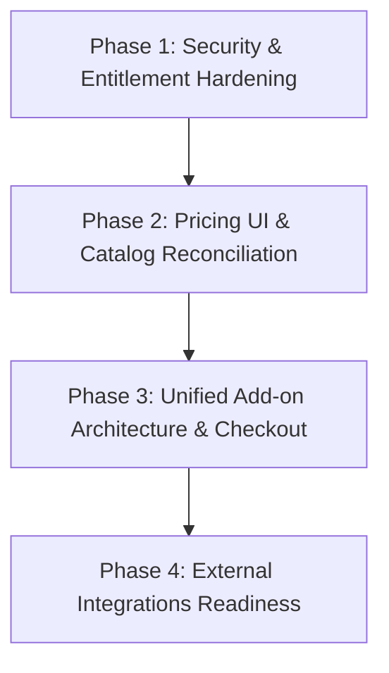

# Codeaxys AI Website Builder — Definitive Feature Audit & Pricing Entitlement Specification

**Document Version:** 1.0.0  
**Date:** October 15, 2026  
**Status:** Read-Only Audit & Specification (Pre-Implementation Deliverable)  
**Target Environment:** Development / Staging / Production Architecture  
**Author:** Antigravity System Architect & Platform Engineering

---

## 1. Executive Summary

### 1.1 Objective & Scope
This document provides a comprehensive, read-only architectural audit of the Codeaxys AI Website Builder codebase. Its purpose is to resolve long-standing ambiguities between what customer-facing pricing pages claim, what centralized plan configuration defines, and what backend route handlers and database tables actually enforce.

Specifically, this specification:
1. Verifies the exact feature boundaries of the approved base subscription plans: **Starter**, **Pro**, **Business**, and **Agency**.
2. Formulates the exact scope, boundaries, and eligibility for **ONE optional paid Digital Marketing & Growth Add-on**.
3. Classifies every major product capability by its verified implementation status: **Fully Operational**, **Partially Implemented**, **Mock-Only / Preview**, **Disabled**, or **Not Implemented (Phantom Feature)**.
4. Identifies critical server-side entitlement bypasses, security gaps, and marketing copy discrepancies that must be resolved before launching commercial billing.

### 1.2 Core Approved Pricing & Plan Limits (Strict Invariant)
The approved base subscription pricing, billing intervals, and capacity quotas are strictly preserved across all analyses in this document:

| Plan | Monthly | 12 Months (Prepaid) | 36 Months (Prepaid) | Websites | AI Credits/Mo | Storage Quota | Custom Domain Connections | 36-Mo Free Domain Offer |
| :--- | :---: | :---: | :---: | :---: | :---: | :---: | :---: | :---: |
| **Starter** | ₹299 | ₹2,990 (16.67% off) | ₹6,997 (35% off) | 1 | 100 | 2 GB | 1 Domain | Max 1 Free (1st Yr Free)* |
| **Pro** | ₹599 | ₹5,990 (16.67% off) | ₹14,017 (35% off) | 3 | 200 | 10 GB | 3 Domains | Max 1 Free (1st Yr Free)* |
| **Business** | ₹999 | ₹9,990 (16.67% off) | ₹23,377 (35% off) | 6 | 400 | 30 GB | 6 Domains | Max 1 Free (1st Yr Free)* |
| **Agency** | ₹1,999 | ₹19,990 (16.67% off) | ₹46,777 (35% off) | 15 | 800 | 100 GB | 15 Domains | Max 1 Free (1st Yr Free)* |

*\*Note on Domain Offer:* The 36-month domain offer grants a maximum of **ONE (1)** free eligible standard domain registration (`.com`, `.in`, `.net`, `.org`) for Year 1 across all plans. Multiple website slots do not grant multiple free domain registrations.

### 1.3 Key Architectural Findings
1. **The Core Website Builder is Fully Functional:** The generative AI website builder, visual block canvas, unlimited page creation, responsive design engine, clean HTML/CSS exporter, custom domain routing via Vercel DNS, media asset uploads with storage limits, and atomic AI credit accounting with 30-day replenishments are completely implemented and operating reliably.
2. **Advanced SEO Entitlement Discrepancy:** The pricing UI states that "Autonomous SEO Autopilot" is reserved for Business and Agency plans. However, the backend route handler (`app/api/websites/[id]/seo/autopilot/route.ts`) checks `checkAdvancedSeoEntitlement()`, which explicitly grants access to **Pro**, Business, and Agency subscribers.
3. **Backend Route Entitlement Leaks:**
   - `app/api/websites/[id]/marketing/agent/route.ts`: Has **zero** subscription tier check. Any authenticated user (including Free Trial and Starter users) with 5 credits can use the AI Marketing Agent.
   - `app/api/websites/[id]/seo/google-ads/customers/route.ts`: Allows access if `canUseFeature(planId, "basic_seo")` is true. Because `basic_seo` is granted to all plans (including Free), this entitlement check effectively fails open.
   - `app/api/websites/[id]/blog/route.ts` and `app/api/websites/[id]/blog/generate/route.ts`: Free and Starter users can generate and manage blog posts, even though "Blog & Content Manager" is marketed only on Pro and Business cards.
4. **Mock-Only & Partially Operational Modules:**
   - **Multi-Engine AI Visibility Tracker:** Currently operates in mock mode. By default, `FEATURE_LIVE_AI_VISIBILITY = false` in `lib/ai-visibility/config.ts`. It returns synthetic citation responses and deducts 0 credits. Live operation requires third-party API keys (OpenAI, Perplexity, Anthropic, Gemini) and `FEATURE_LIVE_AI_VISIBILITY=true`.
   - **Google Ads Integration:** OAuth flow and AI Search campaign strategy generation are operational. However, live automated campaign mutations via Google Ads API require a verified `GOOGLE_ADS_DEVELOPER_TOKEN` and `GOOGLE_ADS_ENABLE_LIVE_MUTATIONS=true`. It currently operates in safe `draft_strategy` mode (`draft_strategy_prepared`).
   - **Meta Paid Ads V1:** Fully operational for draft creation and sequential campaign publishing (`PAUSED` status) via the Meta Graph API when a user connects their Meta Ad Account.
5. **Phantom Claims (Not Implemented):**
   - **Team Collaboration (3 Users / 10 Users):** Marketed on the Business and Agency cards. There is no database table, no organization model, no invite route, and zero lines of code in `lib/` or `app/` implementing team accounts.
   - **API Access (where available):** Marketed on the Agency card. No public customer-facing API or API key management system exists; only third-party connectors (Moz, Ahrefs, Semrush) exist.
   - **Domain Registrar API:** Codeaxys does not operate an automated registrar API. Domains connected are customer-owned; the 36-month free domain offer is an administrative entitlement/voucher policy.

---

## 2. Verified Base Plan Feature Matrix

The following matrix documents the verified capabilities across the normal subscription tiers based on code inspection.

| Feature / Capability | Free (10-Day Trial) | Starter (₹299/mo) | Pro (₹599/mo) | Business (₹999/mo) | Agency (₹1,999/mo) | Backend Verification Source |
| :--- | :---: | :---: | :---: | :---: | :---: | :--- |
| **Active Website Allowance** | 1 Site (10-Day TTL) | 1 Site | 3 Sites | 6 Sites | 15 Sites | `lib/constants.ts:43-144`, `lib/billing.ts:453` |
| **Monthly AI Credits** | 50 (One-time trial) | 100 / month | 200 / month | 400 / month | 800 / month | `lib/constants.ts:4-19`, `lib/billing.ts:37-45` |
| **Cloud Storage Quota** | 100 MB | 2 GB | 10 GB | 30 GB | 100 GB | `app/api/media/upload/route.ts:55-67` |
| **Subdomain Hosting** | Included (`*.codeaxys.com`) | Included | Included | Included | Included | `lib/site-renderer.ts:45-120` |
| **Customer Domain Connection** | ❌ (Blocked) | 1 Domain | Up to 3 Domains | Up to 6 Domains | Up to 15 Domains | `app/api/websites/[id]/domain/route.ts:93-125` |
| **36-Mo Free Domain Registration** | ❌ | Max 1 Domain* | Max 1 Domain* | Max 1 Domain* | Max 1 Domain* | `lib/billing-periods.ts:37-51, 176-185` |
| **AI Website Builder & Canvas** | Included | Included | Included | Included | Included | `app/api/generate/route.ts`, `app/api/edit/route.ts` |
| **Visual Section Drag & Drop** | Included | Included | Included | Included | Included | `components/editor/VisualEditor.tsx` |
| **Unlimited Pages per Website** | Included | Included | Included | Included | Included | `app/site/[slug]/route.ts`, `app/sitemap/[slug]` |
| **SSL Certificates** | Automatic | Automatic | Automatic | Automatic | Automatic | Handled via Vercel Edge Network |
| **Basic SEO Essentials** | Included | Included | Included | Included | Included | `app/api/websites/[id]/seo/route.ts:1-228` |
| **XML Sitemaps & Robots.txt** | Included | Included | Included | Included | Included | `app/sitemap/[slug]/route.ts`, `app/robots.txt` |
| **Cheerio SEO Audits & Scoring** | Included | Included | Included | Included | Included | `lib/seo-job-processor.ts:executeSEOAnalysis` |
| **Contact Form Lead Capture** | Included | Included | Included | Included | Included | `app/api/websites/[id]/leads/route.ts:1-37` |
| **Lead Inbox & Status Tracking** | Included | Included | Included | Included | Included | `app/api/websites/[id]/marketing/leads/route.ts` |
| **Blog & Content Engine** | Operational* | Operational* | Included (Marketed) | Included (Marketed) | Included (Marketed) | `app/api/websites/[id]/blog/route.ts:1-170` |
| **Technical Crawl & Diagnostics** | ❌ Blocked | ❌ Blocked | Included | Included | Included | `app/api/websites/[id]/seo/technical/crawl/route.ts` |
| **JSON-LD Schema Generator** | ❌ Blocked | ❌ Blocked | Included | Included | Included | `lib/features.ts:31-51`, `lib/billing.ts:177` |
| **Competitor Gap Intelligence** | ❌ Blocked | ❌ Blocked | Included | Included | Included | `app/api/websites/[id]/seo/competitors/route.ts` |
| **Google Search Console Sync** | ❌ Blocked | ❌ Blocked | Included | Included | Included | `app/api/websites/[id]/seo/gsc/sync/route.ts` |
| **AEO, GEO & AIO Analysis** | ❌ Blocked | ❌ Blocked | Included | Included | Included | `app/api/websites/[id]/seo/aeo/route.ts`, `geo/`, `aio/` |
| **Dedicated AI SEO Agent** | ❌ Blocked | ❌ Blocked | Included (5 cr) | Included (5 cr) | Included (5 cr) | `app/api/websites/[id]/seo/agent/route.ts:36-47` |
| **SEO Autopilot & Fix Agent** | ❌ Blocked | ❌ Blocked | Operational (Gap)* | Included | Included | `app/api/websites/[id]/seo/autopilot/route.ts:88` |
| **Meta Paid Ads Strategy Planner** | ❌ Blocked | ❌ Blocked | Included | Included | Included | `app/api/websites/[id]/marketing/plan/route.ts:98` |
| **Meta Ads Graph API Publisher** | ❌ Blocked | ❌ Blocked | Included | Included | Included | `app/api/websites/[id]/marketing/plan/[draftId]/publish` |
| **Unified Marketing Agent** | Leak (Open)* | Leak (Open)* | Included (5 cr) | Included (5 cr) | Included (5 cr) | `app/api/websites/[id]/marketing/agent/route.ts:9` |
| **White-Label Client Reports** | ❌ Blocked | ❌ Blocked | ❌ Blocked | ❌ Blocked | Included (Exclusive) | `app/api/websites/[id]/seo/reports/white-label/route.ts` |
| **Third-Party SEO Integrations** | ❌ Blocked | ❌ Blocked | ❌ Blocked | ❌ Blocked | Included (Exclusive) | `app/api/websites/[id]/seo/integrations/[provider]/connect` |
| **Multi-Engine AI Visibility** | Mock Mode | Mock Mode | Mock Mode | Mock Mode | Mock Mode | `lib/ai-visibility/config.ts:8, 28` |
| **Google Ads Live Mutations** | Draft Only | Draft Only | Draft Only | Draft Only | Draft Only | `lib/marketing/google-publisher.ts:58-66` |
| **Multi-User Team Collaboration**| ❌ Not Impl. | ❌ Not Impl. | ❌ Not Impl. | ❌ Not Impl. (Claim) | ❌ Not Impl. (Claim) | Absent from codebase |
| **Customer Developer API** | ❌ Not Impl. | ❌ Not Impl. | ❌ Not Impl. | ❌ Not Impl. | ❌ Not Impl. (Claim) | Absent from codebase |

*\*Notes on Operational Status:*
- *Blog Engine:* Currently accessible to all authenticated website owners because `app/api/websites/[id]/blog/route.ts` has no plan guard.
- *SEO Autopilot Gap:* Pro tier currently passes the backend check `checkAdvancedSeoEntitlement()`, despite UI marketing stating it starts at Business.
- *Marketing Agent Leak:* `app/api/websites/[id]/marketing/agent/route.ts` lacks a plan guard and only checks credit balance.

---

## 3. Feature-by-Feature Implementation Status & Code Evidence

This section traces every subsystem from the frontend UI to backend controllers, libraries, and database tables.

### 3.1 Core Website Generation, Visual Editing & Canvas
- **Implementation Status:** **Fully Operational**
- **Credit Consumption:**
  - Initial generation: 10 AI credits (`CREDIT_COSTS.INITIAL_GENERATION`).
  - Visual refinement / edit: 5 AI credits (`CREDIT_COSTS.AI_EDIT`).
  - Full regeneration: 15 AI credits (`CREDIT_COSTS.FULL_REGENERATION`).
- **Code Evidence:**
  - API Routes: `app/api/generate/route.ts` (lines 72–125), `app/api/edit/route.ts` (lines 57–130).
  - Business Logic: `lib/gemini.ts` (`generateWebsite()`, `editWebsite()`).
  - Plan Enforcement: `lib/billing.ts:checkWebsiteLimit()` (lines 453–464), `lib/billing.ts:checkCreditBalance()` (lines 466–482).
  - Atomic Deduction: `lib/billing.ts:deductCreditsWithClient()` invokes Postgres RPC `deduct_user_credits` with `FOR UPDATE` row-level locks.
  - Failure Refunds: `lib/billing.ts:refundCredits()` invokes Postgres RPC `refund_user_credits`.

### 3.2 Hosting, Subdomains, & Publishing
- **Implementation Status:** **Fully Operational**
- **Capabilities:** Static multi-page routing, edge SSR rendering, published state toggle, slug sanitization, and custom subdomain provisioning (`slug.codeaxys.com`).
- **Code Evidence:**
  - Dynamic Site Resolver: `app/site/[slug]/route.ts` (lines 1–110).
  - HTML Renderer: `lib/site-renderer.ts` (lines 1–280).
  - Publishing API: `app/api/websites/[id]/publish/route.ts` (lines 1–160).
  - Database Table: `public.websites` (`is_published`, `published_slug`, `custom_domain`, `custom_domain_status`).

### 3.3 Custom Domain Connections & Vercel DNS
- **Implementation Status:** **Fully Operational**
- **Capabilities:** Customer connects external domain (e.g. `example.com`), receives required CNAME (`cname.vercel-dns.com`) or A record (`76.76.21.21`), with automated verification polling against Vercel Edge API.
- **Plan Enforcement:**
  - Free plan: Blocked (`allow_custom_domain: false`).
  - Starter: Capped at strictly 1 custom domain (`app/api/websites/[id]/domain/route.ts`, lines 108–125).
  - Pro (3), Business (6), Agency (15): Implicitly capped by the website slot quota, because each website row holds at most 1 custom domain.
- **Code Evidence:**
  - API Routes: `app/api/websites/[id]/domain/route.ts` (lines 1–306), `app/api/websites/[id]/domain/verify/route.ts` (lines 1–85).
  - Verification Library: `lib/domain-verification.ts` (`verifyDomainWithVercel()`, `removeDomainFromVercel()`).

### 3.4 36-Month Prepaid 1 Free Domain Offer
- **Implementation Status:** **Operational Billing Logic / Administrative Domain Policy**
- **Capabilities:** The domain offer is an administrative policy granting exactly 1 free standard domain (`.com`, `.in`, `.net`, `.org`) for Year 1 on any qualifying 36-month prepaid plan. It is strictly optional.
- **Code Evidence:**
  - Policy Definition: `lib/billing-periods.ts` (`APPROVED_DOMAIN_OFFER_POLICY`, lines 45–51).
  - Quota Calculation: `lib/billing-periods.ts:calculatePlanPrice()` (lines 176–185) strictly sets `freeDomainRegistrationCount = optedIn ? 1 : 0` across all plans (Starter, Pro, Business, Agency).
  - Disclaimer Enforcement: `app/pricing/page.tsx` (lines 523–573) renders an interactive tooltip disclosing that higher tiers allow more customer-owned domain connections, but do NOT grant multiple free domain registrations.

### 3.5 Storage & Media Asset Management
- **Implementation Status:** **Fully Operational**
- **Capabilities:** Image uploads (JPEG, PNG, WebP, SVG) up to 5 MB per file, stored in Supabase Storage bucket `website-assets`.
- **Plan Enforcement:**
  - Free: 100 MB (`104,857,600` bytes).
  - Starter: 2 GB (`2,147,483,648` bytes).
  - Pro: 10 GB (`10,737,418,240` bytes).
  - Business: 30 GB (`32,212,254,720` bytes).
  - Agency: 100 GB (`107,374,182,400` bytes).
- **Code Evidence:**
  - Upload Route: `app/api/media/upload/route.ts` (lines 32–67).
  - Quota Enforcement: Lines 55–67 calculate `projectedStorage = usage.storage.usedBytes + file.size` and return `ERROR_CODES.STORAGE_LIMIT_REACHED` (400) if exceeded.

### 3.6 AI Credits & Automatic 30-Day Replenishment
- **Implementation Status:** **Fully Operational**
- **Capabilities:** Monthly credit grants without rollover. Active annual (12-month) and triennial (36-month) prepaid subscribers have their credits automatically refreshed every 30 days based on `last_credit_refreshed_at`.
- **Code Evidence:**
  - Replenishment Engine: `lib/billing.ts:replenishSubscriptionCredits()` (lines 291–323) invokes `resetMonthlyAllowanceWithoutRollover()`.
  - Auto-Trigger: `lib/billing.ts:getUserUsage()` (lines 379–394) checks `isCreditReplenishmentDue(sub)` and triggers replenishment inline.
  - Database Table: `public.user_credits`, `public.ai_credit_transactions`.

### 3.7 Basic SEO & On-Page Essentials
- **Implementation Status:** **Fully Operational**
- **Capabilities:** On-page metadata editing (title, description, focus keywords, canonical URL), robots directives (`index`, `follow`), OpenGraph / Twitter cards, Google Search Console verification token, dynamic XML sitemaps (`/sitemap.xml`), robots.txt, and local Cheerio HTML parsing/scoring.
- **Plan Eligibility:** Included in all tiers (Free, Starter, Pro, Business, Agency).
- **Code Evidence:**
  - Controller: `app/api/websites/[id]/seo/route.ts` (GET & PUT handlers, lines 1–228).
  - Scoring & Analyzer: `lib/seo-job-processor.ts:executeSEOAnalysis()`.
  - Dynamic Sitemap: `app/sitemap/[slug]/route.ts`.

### 3.8 Advanced SEO Suite
- **Implementation Status:** **Fully Operational**
- **Capabilities:**
  1. *Technical Site Crawl:* Multi-page crawler detecting broken links, sitemap discrepancies, robots.txt crawl directives, and DOM issues.
  2. *JSON-LD Schema Generator:* Structured data builder for Organizations, Local Businesses, and Breadcrumbs.
  3. *Competitor Gap Intelligence:* Tracks competitor domains, organic keyword overlap, and content gaps.
  4. *Google Search Console Performance Sync:* OAuth connection to GSC, fetching search queries, impressions, clicks, CTR, and average position.
  5. *AEO, GEO & AIO Analysis:* Evaluates answer engine answerability, generative engine optimization, and AI overview visibility.
- **Plan Eligibility:** Pro, Business, and Agency. Blocked on Free and Starter.
- **Code Evidence:**
  - Server Entitlement Check: `lib/billing.ts:checkAdvancedSeoEntitlement()` (lines 183–225).
  - Technical Crawl: `app/api/websites/[id]/seo/technical/crawl/route.ts` (lines 83–94).
  - Competitor Intelligence: `app/api/websites/[id]/seo/competitors/route.ts` (lines 86–94).
  - GSC Performance Sync: `app/api/websites/[id]/seo/gsc/sync/route.ts` (lines 40–48).
  - AEO Engine: `app/api/websites/[id]/seo/aeo/route.ts` (lines 50–56).
  - GEO Engine: `app/api/websites/[id]/seo/geo/route.ts` (lines 22–29).
  - AIO Engine: `app/api/websites/[id]/seo/aio/route.ts` (lines 22–30).

### 3.9 Dedicated AI SEO Agent
- **Implementation Status:** **Fully Operational**
- **Capabilities:** Conversational assistant specifically contextualized with website page content, competitor rankings, and crawl issues, delivering structured recommendations and content rewrites.
- **Credit Cost:** 5 AI credits per query (`CREDIT_COSTS.SEO_AGENT`).
- **Plan Eligibility:** Pro, Business, and Agency. Blocked on Free and Starter.
- **Code Evidence:**
  - API Controller: `app/api/websites/[id]/seo/agent/route.ts` (lines 35–47).
  - Logic & Context Engine: `lib/seo-agent.ts` (`buildSEOContext()`, `generateSEOAgentResponse()`).
  - Entitlement Guard: Lines 39–47 verify `canUseFeature(planId, "ai_seo")`.

### 3.10 SEO Autopilot & Fix Agent
- **Implementation Status:** **Fully Operational (With Entitlement Discrepancy)**
- **Capabilities:** Autonomous background scan discovering actionable SEO opportunities (missing metadata, unoptimized headings, missing alt attributes, schema gaps), staging non-destructive fixes, and applying 1-click self-healing code updates with full rollback history.
- **Plan Discrepancy:**
  - *Pricing UI Claim:* Advertised as starting on **Business** and **Agency** plans (`bundleInclusions.added` on Pro).
  - *Backend Reality:* `app/api/websites/[id]/seo/autopilot/route.ts` (lines 88–95) enforces `checkAdvancedSeoEntitlement()`, which allows **Pro**, Business, and Agency!
- **Code Evidence:**
  - API Controller: `app/api/websites/[id]/seo/autopilot/route.ts` (lines 1–114).
  - Opportunity Engine: `lib/seo-opportunities/autopilot.ts` (`getAutopilotSettings()`, `updateAutopilotSettings()`, `runAutopilotCycle()`).
  - Database Tables: `public.seo_opportunities`, `public.seo_autopilot_activity`, `public.seo_autopilot_settings`.

### 3.11 Multi-Engine AI Visibility & LLM Tracker
- **Implementation Status:** **Mock-Only / Preview Mode (Not Operational in Production)**
- **Operational Reality:**
  - Feature Flag: `lib/ai-visibility/config.ts` (line 8) explicitly sets `DEFAULT_FEATURE_ENABLED: false`.
  - Adapter Guard: `lib/ai-visibility/adapters/openai-adapter.ts` (lines 38–52) checks `!isLiveAiVisibilityEnabled()` and returns synthetic mock citations with `status: "failed"` and `isMock: true`.
  - Credit Waiver: `lib/ai-visibility/credit-guard.ts` (line 98–100) sets `creditsRequired = 0` when live mode is disabled.
  - Operational Dependency: Operating live requires 4 external API keys (`OPENAI_API_KEY`, `PERPLEXITY_API_KEY`, `ANTHROPIC_API_KEY`, `GEMINI_API_KEY`) with active search grounding and substantial external token costs.
- **Code Evidence:**
  - Configuration: `lib/ai-visibility/config.ts` (lines 1–41).
  - Credit Guard: `lib/ai-visibility/credit-guard.ts` (lines 42–105).
  - Adapters: `lib/ai-visibility/adapters/openai-adapter.ts`, `perplexity-adapter.ts`, `gemini-adapter.ts`, `claude-adapter.ts`.

### 3.12 Meta Paid Ads V1 (Campaign Planner & Publisher)
- **Implementation Status:** **Fully Operational**
- **Capabilities:**
  1. *OAuth Discovery:* Discovers user’s Meta Ad Accounts, Facebook Pages, and Instagram profiles (`app/api/websites/[id]/marketing/connect/route.ts`, `lib/marketing/meta-client.ts`).
  2. *Strategy Planning:* AI generates complete ad structures (campaign objectives, daily budget, targeting criteria, ad copy, headlines, creative suggestions).
  3. *Explicit Approval Workflow:* Requires user to review approval snapshot and explicitly click "Approve & Launch".
  4. *Sequential Publishing:* Creates Campaign -> Ad Set -> Creative -> Ad via Meta Graph API v20.0 with idempotency keys. All objects are strictly created with status `PAUSED` to prevent unreviewed ad spend.
- **Plan Eligibility:** Pro, Business, Agency (`checkMarketingPlanEntitlement()`).
- **Code Evidence:**
  - Publisher Engine: `lib/marketing/meta-publisher.ts` (`executeMetaCampaignPublish()`, lines 1–450).
  - API Controller: `app/api/websites/[id]/marketing/plan/[draftId]/publish/route.ts` (lines 1–111).
  - Entitlement Check: Lines 21–33 call `checkMarketingPlanEntitlement(user.id, supabase)`.

### 3.13 Google Ads Integration
- **Implementation Status:** **Partially Operational / Draft-Only Mode**
- **Operational Reality:**
  - Strategy Planning: Operational. Generates Responsive Search Ads (RSA), headlines, descriptions, positive keywords, and negative keywords (`lib/marketing/google-strategy.ts`).
  - Live Mutations: **Disabled / Draft-Only.** `lib/marketing/google-publisher.ts` (lines 58–66) checks `checkDeveloperTokenStatus()`. Unless `GOOGLE_ADS_DEVELOPER_TOKEN` is verified and `GOOGLE_ADS_ENABLE_LIVE_MUTATIONS="true"`, all executions complete with `status: "draft_strategy_prepared"` and `mode: "draft_strategy"`.
  - Feature Flag: In `lib/marketing/marketing-agent-ai.ts` (line 30), `FEATURE_FLAGS.GOOGLE_ADS_ENABLED = false` temporarily hides Google Ads recommendations in conversational UI.
- **Code Evidence:**
  - Publisher Engine: `lib/marketing/google-publisher.ts` (lines 1–390).
  - Token Checker: `lib/google-ads-client.ts:checkDeveloperTokenStatus()` (lines 32–44).
  - API Route: `app/api/websites/[id]/marketing/google/publish/route.ts` (lines 1–92).

### 3.14 Unified Marketing Agent
- **Implementation Status:** **Operational (With Security Entitlement Gap)**
- **Capabilities:** Conversational marketing expert powered by Gemini 2.5 Flash. Ingests business context, landing pages, forms, and ad goals to propose tailored campaign strategies.
- **Credit Cost:** 5 AI credits per query (`CREDIT_COSTS.MARKETING_AGENT`).
- **Security Vulnerability:** `app/api/websites/[id]/marketing/agent/route.ts` (lines 9–105) checks authentication, website ownership, rate limiting (20/min), and credit balance, but **never checks the user's subscription tier**. Any user on Free or Starter with 5 credits can query the Marketing Agent.
- **Code Evidence:**
  - API Controller: `app/api/websites/[id]/marketing/agent/route.ts` (lines 1–153).
  - Agent AI Logic: `lib/marketing/marketing-agent-ai.ts` (`generateMarketingAgentReply()`).
  - Cross-Agent Intent Router: `lib/ai/unified-conversation-core.ts`.

### 3.15 Marketing Leads & Contact Form Capture
- **Implementation Status:** **Fully Operational**
- **Capabilities:** Public contact forms on published websites submit directly to `POST /api/websites/[id]/leads`. Submissions are sanitized, assigned source tags (`website_form`, `meta_ads`, etc.), and stored in `public.marketing_leads`. Website owners view their lead inbox in real time.
- **Plan Eligibility:** Available to all website owners regardless of tier.
- **Code Evidence:**
  - Public Ingestion: `app/api/websites/[id]/leads/route.ts` (lines 1–37).
  - Dashboard Inbox: `app/api/websites/[id]/marketing/leads/route.ts` (lines 1–70).
  - Lead Engine: `lib/marketing/lead-engine.ts`.

### 3.16 Campaign Analytics & Optimization Workflows
- **Implementation Status:** **Fully Operational**
- **Capabilities:** Normalizes ad impressions, clicks, spend, CTR, CPC, and conversion leads across campaigns into unified metrics. Rule-based analyzer recommends budget shifts, copy adjustments, and keyword pruning.
- **Plan Eligibility:** Available to website owners with active campaigns.
- **Code Evidence:**
  - Analytics Controller: `app/api/websites/[id]/marketing/analytics/route.ts` (lines 1–60).
  - Optimization Controller: `app/api/websites/[id]/marketing/optimization/route.ts` (lines 1–75).
  - Analytics Engine: `lib/marketing/analytics-engine.ts`.
  - Performance Analyzer: `lib/marketing/performance-analyzer.ts`.

### 3.17 White-Label Client Reports
- **Implementation Status:** **Fully Operational**
- **Capabilities:** Allows agencies to configure agency branding (logo, agency name, primary brand color, unbranded footer) and generate unbranded, client-facing PDF/web performance reports with zero Codeaxys attribution.
- **Plan Eligibility:** Strictly enforced for **Agency** tier only (`canUseFeature(planId, "advanced_integrations")`).
- **Code Evidence:**
  - API Route: `app/api/websites/[id]/seo/reports/white-label/route.ts` (lines 61–73).
  - Report Engine: `lib/seo-reports/engine.ts`.
  - Database Table: `public.seo_white_label_settings`.

### 3.18 Third-Party SEO Integrations & Webhooks
- **Implementation Status:** **Fully Operational**
- **Capabilities:** Connects external SEO analytics providers (Moz, Ahrefs, Semrush) and webhook event dispatches for automated reporting.
- **Plan Eligibility:** Strictly enforced for **Agency** tier only (`canUseFeature(planId, "advanced_integrations")`).
- **Code Evidence:**
  - API Route: `app/api/websites/[id]/seo/integrations/[provider]/connect/route.ts` (lines 21–33).
  - Provider Modules: `lib/seo-integrations/providers/` (`moz.ts`, `ahrefs.ts`, `semrush.ts`).

### 3.19 Blog & Content Manager
- **Implementation Status:** **Fully Operational (With Entitlement Discrepancy)**
- **Capabilities:** Rich text blog editor, AI blog post generation from topics (5 credits), category/tag organization, automated slug routing, sitemap integration, and edge HTML rendering.
- **Plan Discrepancy:** Marketed on the pricing cards for Pro and Business only. However, the backend route handlers (`app/api/websites/[id]/blog/route.ts`) have no plan restriction. Starter users can currently access the blog engine if they navigate directly to `/dashboard/websites/[id]/blog`.
- **Code Evidence:**
  - API Routes: `app/api/websites/[id]/blog/route.ts` (lines 1–170), `app/api/websites/[id]/blog/generate/route.ts` (lines 1–217).
  - Rendering Engine: `lib/blog-renderer.ts`.
  - Sitemap Injection: `app/sitemap/[slug]/route.ts` (lines 39–82).

### 3.20 Team Collaboration (Multi-User Roles)
- **Implementation Status:** **NOT IMPLEMENTED (Phantom Feature)**
- **Code Reality:**
  - Pricing cards claim "Team Collaboration (3 Users)" for Business and "Team Collaboration (10 Users)" for Agency.
  - A comprehensive codebase search reveals **zero** database tables (`teams`, `organizations`, `team_members`), **zero** API endpoints for invites/roles, and **zero** UI components for team management.
  - The feature is completely non-existent.

### 3.21 Public Developer API
- **Implementation Status:** **NOT IMPLEMENTED (Phantom Feature)**
- **Code Reality:**
  - The Agency pricing card claims "API Access (where available)".
  - Codeaxys provides no customer-facing REST/GraphQL API, no API key generation dashboard, and no external webhook ingestion for users.
  - The only external APIs in the codebase are internal client wrappers calling third-party services (Meta Graph API, Google Ads API, Moz, Ahrefs, Semrush).

---

## 4. Base Subscription vs. Digital Marketing & Growth Add-on

A clear architectural boundary must be established between what customers receive as part of their core website subscription and what belongs in an optional paid add-on.

### 4.1 Boundary Principles
1. **Core Product = Website Creation, Hosting, and On-Page Health:** A customer subscribing to a website builder primarily needs to build, host, brand, and maintain an online presence. Essential SEO (meta tags, sitemaps, robots.txt, schema markup, and basic analytics) belongs in the base subscription.
2. **Add-on = Active Customer Acquisition & Outbound Growth:** Digital marketing tools (running paid ads on Meta/Google, autonomous optimization agents, and continuous multi-engine LLM tracking) represent a distinct operational phase. They incur substantial ongoing external API and LLM computing costs and should be packaged as an optional upgrade.
3. **Single Unified Product:** To avoid customer confusion and billing fragmentation, there must be **ONE** Digital Marketing & Growth Add-on. We must not create separate fragmented add-ons for Meta Ads, Google Ads, AI Visibility, or Autopilot.
4. **Zero Double-Charging Rule:** If a capability is already natively included in a customer's base plan, purchasing the add-on must never bill them for that capability or present it as a net-new feature.

### 4.2 Architectural Categorization

| Capability | Base Subscription | Optional Marketing & Growth Add-on | Rationale & Cost Alignment |
| :--- | :---: | :---: | :--- |
| **AI Website Builder & Canvas** | **YES (All Plans)** | ❌ Excluded | Fundamental core functionality of the product. |
| **Unlimited Pages & Cloud Hosting**| **YES (All Plans)** | ❌ Excluded | Core infrastructure provided with every plan. |
| **Customer Domain Connections** | **YES (All Plans)** | ❌ Excluded | Standard DNS routing included with plan limits. |
| **36-Mo Free Domain Offer** | **YES (Policy)** | ❌ Excluded | Software subscription incentive, not a marketing tool. |
| **Cloud Storage & Media Library** | **YES (All Plans)** | ❌ Excluded | Baseline asset storage tied to plan limits. |
| **Basic SEO & XML Sitemaps** | **YES (All Plans)** | ❌ Excluded | Table-stakes functionality for any modern website builder. |
| **Website Form Lead Capture** | **YES (All Plans)** | ❌ Excluded | Essential website functionality; form data must belong to the user. |
| **Blog Engine & Content Manager** | **YES (Pro+)** | ❌ Excluded | On-site content creation tool; belongs in base website builder. |
| **Technical Crawl & Schema Markup**| **YES (Pro+)** | ❌ Excluded | Core on-page website health intelligence. |
| **GSC Search Console Sync** | **YES (Pro+)** | ❌ Excluded | Standard organic performance tracking. |
| **White-Label Client Reports** | **YES (Agency)** | ❌ Excluded (In Agency) | Core agency deliverable; already included in Agency plan. |
| **Unified Marketing Agent** | Pro+ (Current)* | **YES (Add-on Core)** | High-value Gemini-driven ad planning and ad optimization. |
| **Meta Paid Ads V1 Publisher** | Pro+ (Current)* | **YES (Add-on Core)** | Direct ad account creation and sequential campaign launch. |
| **Google Ads Campaign Planner** | Pro+ (Current)* | **YES (Add-on Core)** | Responsive search ad structure, keyword/negative planning. |
| **Campaign Analytics & Ad ROI** | Pro+ (Current)* | **YES (Add-on Core)** | Aggregated paid ad metrics, spend tracking, and lead attribution. |
| **Autonomous SEO Autopilot** | Business+ | **YES (For Starter/Pro)** | Self-healing autonomous crawler; provides huge value to lower tiers. |
| **Multi-Engine AI Visibility** | Preview Only | **YES (Once Live)** | Continuous brand prompt tracking across ChatGPT, Perplexity, etc. |

---

## 5. Recommended Customer-Facing Feature Lists for Base Plans

To eliminate misleading claims, ensure complete transparency, and accurately reflect verified code entitlements, the following exact feature lists are recommended for the pricing cards.

### 5.1 Starter Plan (₹299/mo · ₹2,990/yr · ₹6,997/36m)
*Target: Solopreneurs, personal brands, and new ventures creating their first online presence.*
- **1 Website** on fast global cloud hosting
- **100 AI Credits / month** (Replenished every 30 days)
- **2 GB Media Storage** for images and assets
- **Connect 1 Custom Domain** (Customer-owned domain connection)
- **Free Codeaxys Subdomain** (`yourname.codeaxys.com`)
- **1 Free Custom Domain for 1 Year** (Optional 36-month prepaid offer)
- **Conversational AI Website Builder** (Full generation and refinement)
- **Visual Drag-and-Drop Canvas** & Section Editor
- **Unlimited Page Creation** (Home, About, Services, Contact, etc.)
- **Mobile Responsive Design** with auto-optimization
- **Basic SEO Essentials** (Custom meta tags, sitemaps, robots.txt, OpenGraph)
- **Website Lead Capture Form** with dashboard inbox viewer
- **SSL Certificate** (Free automatic HTTPS)
- **Clean HTML & CSS Export**

### 5.2 Pro Plan (₹599/mo · ₹5,990/yr · ₹14,017/36m)
*Target: Growing businesses, professionals, and active service providers.*
- **Everything in Starter, plus:**
- **3 Websites** on high-performance infrastructure
- **200 AI Credits / month** (Replenished every 30 days)
- **10 GB Media Storage** quota
- **Connect up to 3 Custom Domains** (1 per website)
- **1 Free Custom Domain for 1 Year** (Optional 36-month prepaid offer)
- **Advanced SEO Intelligence Suite:**
  - Deep Technical Crawl & Broken Link Diagnostics
  - JSON-LD Structured Data & Rich Snippet Generator
  - Competitor Gap Analysis & Organic Keyword Tracking
  - Google Search Console (GSC) Direct Performance Sync
  - AEO (Answer Engine Optimization) & AI Overview Scoring
- **Dedicated AI SEO Assistant** (Interactive conversational agent)
- **Integrated Blog & Content Manager** (Create and publish SEO articles)
- **Standard Priority Email Support**

### 5.3 Business Plan (₹999/mo · ₹9,990/yr · ₹23,377/36m)
*Target: Established companies, multi-brand businesses, and high-traffic sites.*
- **Everything in Pro, plus:**
- **6 Websites** on dedicated edge cloud hosting
- **400 AI Credits / month** (Replenished every 30 days)
- **30 GB Media Storage** quota
- **Connect up to 6 Custom Domains** (1 per website)
- **1 Free Custom Domain for 1 Year** (Optional 36-month prepaid offer)
- **Autonomous SEO Autopilot & Fix Agent:**
  - Automated weekly architecture and crawl scans
  - Non-destructive metadata and schema staging
  - 1-Click self-healing code enhancements with rollback history
- **Topical Authority & Semantic Keyword Graph**
- **Enhanced Asset Bandwidth & CDN Caching**
- **Priority Customer Support**

### 5.4 Agency Plan (₹1,999/mo · ₹19,990/yr · ₹46,777/36m)
*Target: Web design studios, digital agencies, freelancers, and multi-client operators.*
- **Everything in Business, plus:**
- **15 Websites** on enterprise-grade infrastructure
- **800 AI Credits / month** (Replenished every 30 days)
- **100 GB Media Storage** quota
- **Connect up to 15 Custom Domains** (1 per website)
- **1 Free Custom Domain for 1 Year** (Optional 36-month prepaid offer)
- **White-Label Client Reports:**
  - Custom agency logo, brand colors, and company footer
  - Unbranded shareable client web reports
  - Exportable white-label PDF executive summaries
  - Zero Codeaxys platform attribution on client-facing deliverables
- **Third-Party SEO Integrations** (Moz, Ahrefs, and Semrush connector tools)
- **Dedicated Priority Support Channel**

---

## 6. Proposed Digital Marketing & Growth Add-on Specification

### 6.1 Product Concept
The **Digital Marketing & Growth Add-on** is a single, optional, premium subscription upgrade. It turns Codeaxys from a passive website builder into an active customer acquisition engine by providing AI ad strategy, direct Meta ad publishing, Google Search ad planning, performance analytics, and autonomous SEO self-healing.

### 6.2 Capabilities Included in the Add-on

| Capability | In Add-on? | Operational Status | Customer Value Delivered |
| :--- | :---: | :---: | :--- |
| **Unified Marketing Agent** | **YES** | Operational | Acts as a 24/7 AI Paid Ads Strategist. Analyzes landing pages and crafts conversion-focused ad structures. |
| **Meta Paid Ads V1 Publisher** | **YES** | Operational | Direct creation of Campaigns, Ad Sets, Creatives, and Ads on Facebook & Instagram in safe `PAUSED` state. |
| **Google Search Ads Planner** | **YES** | Operational (Draft) | Automatically crafts Responsive Search Ads, 15 headlines, 4 descriptions, keyword match types, and negatives. |
| **Cross-Channel Campaign Analytics** | **YES** | Operational | Unified dashboard tracking ad spend, impressions, clicks, CPC, CTR, and lead attribution. |
| **SEO Autopilot & Fix Agent** | **YES\*** | Operational | Included for Starter and Pro subscribers who do not have Autopilot natively in their base plan. |
| **Multi-Engine AI Visibility Tracker** | **YES\*\*** | Mock-Only (Preview) | When activated live, monitors brand presence and sentiment across ChatGPT, Perplexity, Claude, and Gemini. |
| *Google Ads Live Mutations* | ❌ Excluded | Disabled | Excluded from marketing until Google Ads Developer Token approval is verified. |
| *Team Collaboration* | ❌ Excluded | Not Implemented | Excluded until multi-user organization models are developed. |
| *Creative Image / Video Generation* | ❌ Excluded | Not in Scope | Excluded to keep product scope focused on ads management. |
| *Organic Social Media Publishing* | ❌ Excluded | Not in Scope | Excluded; not part of current architecture. |

### 6.3 Plan Eligibility & The Zero Double-Charging Matrix

Because base plans already provide varying levels of marketing and SEO capabilities, the add-on must dynamically adjust its inclusions and value proposition based on the user's base plan:

| Base Plan | Add-on Status | Inclusions Granted by Add-on | Capabilities Already in Base Plan (Not Charged) |
| :--- | :---: | :--- | :--- |
| **Starter** | **Eligible** | • Unified Marketing Agent<br>• Meta Paid Ads V1 Publisher<br>• Google Search Ads Planner<br>• Campaign Analytics & Optimization<br>• SEO Autopilot & Fix Agent<br>• AI Visibility Tracker (Preview) | • Core Builder<br>• Subdomain & Custom Domain<br>• Basic SEO Essentials<br>• Website Form Lead Capture |
| **Pro** | **Eligible** | • SEO Autopilot & Fix Agent<br>• AI Visibility Tracker (Preview)<br>• (Optional: White-Label Reports if bundled) | • Advanced SEO Suite<br>• Technical Crawl & Schema<br>• Competitor Tracking<br>• Blog Engine<br>• Meta Ads Planning (Native in Pro) |
| **Business** | **Eligible (Restricted)**| • AI Visibility Tracker (Preview)<br>• (Optional: White-Label Reports if bundled) | • Autonomous SEO Autopilot<br>• Advanced SEO Suite<br>• Meta Ads Planning<br>• Blog Engine |
| **Agency** | **Fully Included (₹0)** | **None (100% Natively Included in Base)** | • All SEO Autopilot<br>• All Advanced SEO<br>• All Marketing Tools<br>• White-Label Reports<br>• Third-Party Integrations |

### 6.4 Why Customers Will Pay Extra: The Value Proposition
1. **Agency-Quality Ad Setup in Minutes:** Small business owners struggle to navigate the complex Meta Ads Manager. The add-on generates tested ad copy, target audience parameters, and budget structures in 60 seconds without needing an expensive marketing agency.
2. **Autonomous Website Maintenance:** Starter and Pro users who add the growth bundle gain self-healing SEO Autopilot, saving dozens of hours of manual code edits and keyword research.
3. **High ROI Potential:** A single customer lead generated from a well-targeted Meta ad pays for months of the add-on subscription.

---

## 7. Audit of Inaccurate, Unsupported, or Misleading UI Claims

Our inspection of `app/pricing/page.tsx` and related components identified several claims that contradict the actual codebase:

### 7.1 Phantom Features
1. **"Team Collaboration (3 Users)" (Business Card) & "Team Collaboration (10 Users)" (Agency Card):**
   - *Issue:* Completely unsupported. There is no multi-user schema or authorization logic in the platform.
   - *Correction:* Remove this item from the pricing cards immediately until multi-user authentication is implemented.
2. **"API Access (where available)" (Agency Card):**
   - *Issue:* No public API exists. Only internal routes and outbound connectors exist.
   - *Correction:* Replace with "Advanced Third-Party Integrations (Moz, Ahrefs, Semrush)".

### 7.2 Misleading Operational Status Claims
3. **"AI Visibility & LLM Tracking (Google, ChatGPT, etc.)" advertised as an active capability:**
   - *Issue:* It operates strictly in mock mode (`FEATURE_LIVE_AI_VISIBILITY = false`), returning synthetic responses at zero credit cost.
   - *Correction:* Label explicitly in the UI as **"AI Visibility Tracker (Preview / Beta)"** to maintain truth-in-advertising.
4. **Google Ads Live Publishing:**
   - *Issue:* Strategy generation works, but live campaign mutations require an unverified Google Ads Developer Token.
   - *Correction:* Ensure the pricing card and marketing agent explicitly state: *"Meta Ads campaign publishing included; Google Ads strategy and copy planning supported (direct live publishing requires verified Google Developer credentials)."*

### 7.3 Entitlement & Tier Inconsistencies
5. **SEO Autopilot Placement on Pro vs Business:**
   - *Issue:* Pricing cards claim Autopilot is only in Business/Agency and that Pro users must buy the bundle to get it. However, `app/api/websites/[id]/seo/autopilot/route.ts` allows Pro users to execute Autopilot API cycles.
   - *Correction:* Either formally enforce Business as the minimum tier in `app/api/websites/[id]/seo/autopilot/route.ts` (restricting Pro), or update the Pro pricing card to reflect that Autopilot is included.
6. **"Blog & Content Manager":**
   - *Issue:* Listed on Pro and Business cards as a tier upgrade, but the API has no plan guard, allowing Starter users to use it.
   - *Correction:* Add a server-side plan check to `app/api/websites/[id]/blog/route.ts` restricting access to Pro, Business, and Agency tiers.

---

## 8. Backend Entitlement Gaps and Security Vulnerabilities

The read-only audit revealed several backend endpoints where client requests can bypass intended plan boundaries.

### 8.1 Critical Entitlement Vulnerabilities

#### Gap 1: Unprotected Marketing Agent Endpoint
- **File:** `app/api/websites/[id]/marketing/agent/route.ts`
- **Lines:** 9–105
- **Vulnerability:** The route checks authentication and website ownership, but **fails to check user plan entitlement**.
- **Impact:** Free Trial and Starter users can execute 5-credit conversational queries with the Marketing Agent without subscribing to Pro, Business, Agency, or any marketing add-on.
- **Fix Required:** Add `checkMarketingPlanEntitlement(user.id, dbClient)` before credit deduction.

#### Gap 2: Flawed Google Ads Entitlement Check (Fails Open)
- **File:** `app/api/websites/[id]/seo/google-ads/customers/route.ts`
- **Lines:** 50–57
- **Vulnerability:** Code executes:
  ```typescript
  const allowed = canUseFeature(planId, "basic_seo") || canUseFeature(planId, "advanced_integrations");
  ```
- **Impact:** Because `basic_seo` is `true` for all plans (including `free`), `allowed` is unconditionally true for every registered user.
- **Fix Required:** Replace `basic_seo` with `advanced_integrations` or `canUseFeature(planId, "ai_seo")`.

#### Gap 3: Unrestricted Blog Management Endpoints
- **File:** `app/api/websites/[id]/blog/route.ts` (lines 1–170) and `app/api/websites/[id]/blog/generate/route.ts` (lines 1–217)
- **Vulnerability:** GET, POST, and AI generation handlers verify website ownership but do not enforce the marketed Pro tier requirement.
- **Impact:** Starter and Free users can manage and AI-generate blog posts, undermining the incentive to upgrade to Pro.
- **Fix Required:** Enforce `checkAdvancedSeoEntitlement(user.id)` or add a `blog_engine` key to `PLAN_PERMISSIONS`.

#### Gap 4: Architectural Fragmentation Between `PLAN_PERMISSIONS` and Helper Functions
- **File:** `lib/features.ts` vs `lib/billing.ts`
- **Vulnerability:** `PLAN_PERMISSIONS` in `lib/features.ts` only defines 5 legacy keys (`basic_seo`, `ai_seo`, `advanced_schema`, `analytics`, `advanced_integrations`). However, `lib/billing.ts` introduces ad-hoc helper functions (`checkAdvancedSeoEntitlement`, `checkMarketingPlanEntitlement`) that evaluate plan IDs directly using string checks (`planId === "pro" || planId === "business"`).
- **Fix Required:** Consolidate all feature checks into a unified, typed authorization matrix in `lib/features.ts`.

---

## 9. Cost Inputs and Unresolved Pricing Decisions

Before leadership can finalize a price for the Digital Marketing & Growth Add-on, the underlying external API costs and quota variables must be evaluated.

### 9.1 Variable Cost Inputs

#### 1. Gemini AI Conversational Inference
- **Models Used:** `gemini-2.5-flash` / `gemini-2.5-flash-lite`
- **Cost per Marketing Plan Generation:** ~1,500 input tokens + 800 output tokens ≈ $0.0004 (~₹0.035).
- **Cost per Agent Query:** ~2,000 input tokens + 400 output tokens ≈ $0.0003 (~₹0.025).
- **Verdict:** Extremely cost-efficient. The 5 AI credit deduction adequately covers platform compute expenses.

#### 2. Live AI Visibility Probes (The High-Cost Risk)
If the Multi-Engine AI Visibility Tracker is switched from mock mode to live mode, external provider API costs escalate dramatically:
- **OpenAI (`gpt-4o-mini` with web search):** ~$0.005 – $0.010 per probe.
- **Perplexity (`sonar` grounded search):** $5.00 per 1,000 requests + token costs ≈ $0.008 per probe.
- **Anthropic Claude (`claude-3-5-haiku`):** ~$0.004 per probe.
- **Google Gemini (`gemini-2.5-flash` with Google Search grounding):** $35 per 1,000 search queries = **$0.035 per search query**.
- **Financial Risk Analysis:**
  - A single 4-engine parallel batch probe across all 4 LLMs will cost **~$0.055 (~₹4.60)** in external API fees.
  - If a customer executes 1 batch probe daily (30 probes/month), external API fees reach **$1.65 (~₹138/month)**.
  - If unmetered, a user probing 10 keywords daily would cost Codeaxys **₹1,380/month** in direct API bills, creating a severe negative margin on a low-cost subscription.
- **Mandatory Safeguard:** Live AI Visibility **must** remain hard-capped (e.g. max 15–30 probes/month) and metered against the user's AI credits (e.g. 3 credits per multi-engine batch probe).

#### 3. Meta Graph API & Google Ads API
- **API Access Fees:** $0.00 (Both Meta and Google provide their campaign management APIs free of charge to registered developers).
- **Ad Spend:** Paid directly by the customer to Meta / Google via their linked credit card on the ad account. Codeaxys never finances or fronts client ad spend.

### 9.2 Unresolved Pricing Decisions for Commercial Launch
1. **Add-on Price Point:**
   - Previous placeholder in migration: ₹349/month (Starter add-on).
   - If AI Visibility is kept in mock/preview mode: An add-on price of **₹299/month (or ₹2,490/year)** provides high margin (~85%+ gross margin) for Meta ad planning, ad publishing, analytics, and SEO Autopilot.
   - If live AI Visibility is enabled: Pricing must be set to at least **₹499/month (or ₹4,490/year)** to cover third-party search grounding API costs.
2. **Pro Plan Autopilot Policy:**
   - *Option A (Recommended):* Reserve SEO Autopilot for Business and Agency plans. Pro users can acquire Autopilot by purchasing the Digital Marketing & Growth Add-on.
   - *Option B:* Formally grant Autopilot to Pro in all pricing documentation, adjusting the Business value proposition around capacity (6 sites, 400 credits) and topical authority.
3. **Blog Engine Policy:**
   - Determine whether the Blog Engine should remain free for all tiers, or if server-side guards should be installed restricting blog creation to Pro, Business, and Agency plans.

---

## 10. Recommended Post-Audit Implementation Sequence

Once this audit specification is approved by product leadership and finance, execution should proceed in the following ordered phases:



### Phase 1: Security & Entitlement Hardening
1. Patch `app/api/websites/[id]/marketing/agent/route.ts` to require an active Pro/Business/Agency subscription or active marketing add-on.
2. Fix `app/api/websites/[id]/seo/google-ads/customers/route.ts` to remove the open `basic_seo` condition.
3. Install entitlement checks on `app/api/websites/[id]/blog/route.ts` to restrict blog authoring to Pro+ plans.
4. Harmonize the Pro tier Autopilot check in `app/api/websites/[id]/seo/autopilot/route.ts` with the approved product policy.

### Phase 2: Pricing UI & Feature Catalog Reconciliation
1. Update `app/pricing/page.tsx` to remove phantom features:
   - Remove "Team Collaboration (3/10 Users)".
   - Remove "API Access (where available)".
   - Replace with verified capabilities: "White-Label Client Reports", "Third-Party SEO Integrations", "Blog & Content Engine".
2. Align all feature descriptions with plain-language, non-misleading definitions.
3. Update `lib/pricing/plan-features-catalog.ts` to match the verified feature matrix.

### Phase 3: Unified Add-on Architecture & Single Checkout Integration
1. Consolidate the 7 experimental add-ons in `supabase/migrations/20261015_addon_pricing_foundation.sql` into **ONE** canonical product: `digital_marketing_growth_addon`.
2. Connect `user_addons` verification into `lib/features.ts:canUseFeature()`.
3. Implement the server-side add-on checkout flow in `app/api/billing/checkout/route.ts` enforcing zero double-charging.

### Phase 4: External Integrations Readiness (Deferred Operational Tasks)
1. Complete Google Ads Developer Token application to transition Google Search Ads from `draft_strategy` to live publishing.
2. Secure API keys and budget quotas for Perplexity, OpenAI, and Gemini Search Grounding before toggling `FEATURE_LIVE_AI_VISIBILITY = true`.

---

## Conclusion & Next Steps
This audit establishes an authoritative baseline of the Codeaxys platform. The core website builder, hosting, custom domain connection, and atomic billing engines are solid and production-ready. By resolving the backend entitlement leaks and aligning pricing copy with actual code reality, Codeaxys can launch its base subscriptions and optional Digital Marketing & Growth Add-on with complete financial safety and customer trust.

*Awaiting stakeholder review and approval before beginning Phase 1 implementation.*
